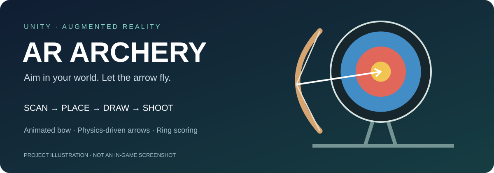
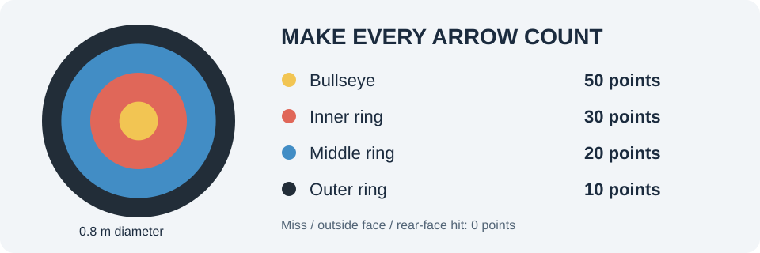
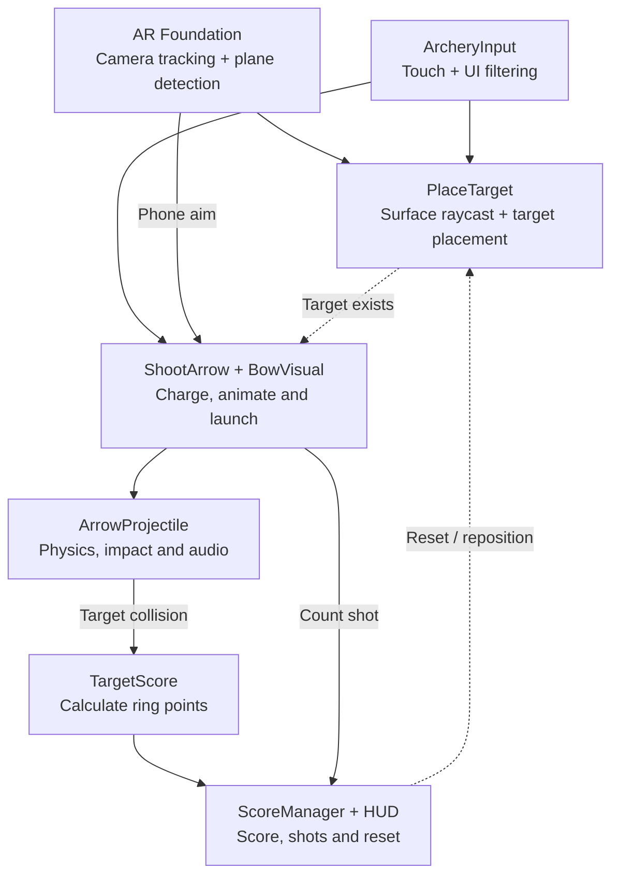

# AR Archery 🏹

**Bring target archery into your surroundings with Unity and augmented reality.**

Scan a real-world surface, place a virtual target, and aim by moving your phone. Hold the screen to draw the bow, then release to launch a physics-driven arrow.



*Project illustration—not an in-game screenshot.*

## Features

- **AR target placement** — detect horizontal surfaces and tap to place a target facing the player.
- **Physical aiming** — the phone's position and orientation control the view and shooting direction.
- **Animated bow** — curved limbs, a visible loaded arrow, string draw, release vibration, and recoil.
- **Charged shots** — launch speed increases from **12 to 28 m/s**, with full charge reached in **0.9 seconds**.
- **Projectile physics** — gravity, continuous collision detection, and arrows that stick to the target.
- **Ring-based scoring** — earn points according to the impact position.
- **Game HUD** — score, shots, hits, aiming crosshair, charge indicator, and instructions.
- **Impact audio** — sound plays when an arrow collides.
- **Reset / reposition** — clear arrows and scores, then place a new target.

## How to play

| Action | Control |
| --- | --- |
| Scan the environment | Move the phone slowly over a well-lit floor |
| Place the target | Tap a detected horizontal surface |
| Aim | Move and rotate your phone |
| Draw the bow | Press and hold the screen |
| Shoot | Release your finger |
| Start again | Tap **Reset / Reposition** |

Start with the target approximately **2–4 metres away**. Aim higher when needed to compensate for gravity; the crosshair shows the camera direction, not a predicted arrow impact.

## Scoring



| Hit area | Points |
| --- | ---: |
| Bullseye | 50 |
| Inner ring | 30 |
| Middle ring | 20 |
| Outer ring | 10 |
| Miss, outside the circular face, or rear-face hit | 0 |

The target has a default diameter of **0.8 m**, with its center placed **1.2 m above** the selected surface. A single arrow can register only one impact.

## Technology

Versions below match the project's checked-in configuration.

| Component | Version |
| --- | --- |
| Unity Editor | **6000.6.3f1** |
| AR Foundation | 6.6.2 |
| ARCore XR Plugin | 6.6.2 |
| ARKit XR Plugin | 6.6.2 |
| XR Plug-in Management | 4.7.0 |
| Unity Input System | 1.20.0 |
| Universal Render Pipeline | 17.6.0 |

**Primary target:** Android. ARKit is included, but iOS builds and device behavior have not been verified.

## Getting started

### Requirements

- Unity Hub and **Unity 6000.6.3f1**.
- Android Build Support, including the Android SDK, NDK, and OpenJDK.
- An ARCore-supported Android phone.
- The current project settings require **Android API level 34 or later** and target **ARM64**.
- Camera permission on the device.

### Open the project

1. Clone this repository:
   ```bash
   git clone https://github.com/onlydivit/AR-Archery.git
   ```
   Alternatively, download the repository ZIP and extract it.
2. In Unity Hub, add the folder containing `Assets`, `Packages`, and `ProjectSettings`.
3. Open it with the matching Unity version and allow package restoration and asset import to complete.
4. Open `Assets/Scenes/SampleScene.unity`.

### Build for Android

1. Select **Android** as the active build target.
2. Confirm **ARCore** is enabled under **Project Settings → XR Plug-in Management → Android**.
3. Ensure `Assets/Scenes/SampleScene.unity` is included in the build.
4. Connect an Android phone with USB debugging enabled.
5. Use **Build and Run**, then allow camera access when prompted.

Mouse input is available in the Editor, but gameplay still requires an active AR tracking session. Editor input alone does not replace device testing.

## Architecture



## Project structure

```text
Assets/
├── Scenes/
│   └── SampleScene.unity
├── Scripts/
│   ├── ArcheryInput.cs
│   ├── PlaceTarget.cs
│   ├── ShootArrow.cs
│   ├── BowVisual.cs
│   ├── ArrowProjectile.cs
│   ├── TargetScore.cs
│   └── ScoreManager.cs
├── prefab/
│   ├── Arrow.prefab
│   └── TargetPlaceholder.prefab
├── Audio/
└── XR/
Packages/
ProjectSettings/
```

Keep Unity `.meta` files with their assets; scene and prefab references depend on their GUIDs. Generated folders such as `Library`, `Temp`, `Logs`, and `UserSettings` are not required in the repository.

## Gameplay settings

| Setting | Default | Location |
| --- | --- | --- |
| Minimum launch speed | 12 m/s | `ShootArrow.minForce` |
| Maximum launch speed | 28 m/s | `ShootArrow.maxForce` |
| Full-charge duration | 0.9 s | `ShootArrow.maxChargeTime` |
| Bow draw distance | 0.1 m | `BowVisual` component |
| Release animation | 0.28 s | `BowVisual` component |
| Target radius | 0.4 m | `TargetScore` component |
| Target center height | 1.2 m | `PlaceTarget` component |
| Arrow lifetime | 12 s | `ArrowProjectile.Awake()` |

Despite their existing names, `minForce` and `maxForce` specify **launch velocity**, not an applied force. For components already saved in a scene, adjust their Inspector values.

## Development status

Implemented gameplay includes placement, charging, bow animation, projectiles, scoring, audio wiring, and reset.

Completed development checks:

- Gameplay scripts compiled against Unity 6000.6.3f1 without warnings or errors.
- Edited scene and prefab references passed static validation.

**Still to verify:** actual device tracking, touch responsiveness, visual animation, high-speed impacts, audio, and an updated Android build. The automated Unity runtime/build attempt was blocked by a licensing-client connection failure; compilation does not establish that mobile gameplay is fully tested.

Target placement follows a detected plane within the current session. Persistent anchors across app restarts are not implemented.

## Troubleshooting

| Problem | Check |
| --- | --- |
| No camera feed or tracking | Camera permission, ARCore support, and XR provider settings |
| Target will not place | Wait for tracking and tap an upward-facing detected horizontal surface |
| Bow does not fire | Place a target first, keep tracking active, and start a fresh touch outside the reset button |
| No score on impact | Arrow/target collider wiring and the active `ScoreManager` |
| Bow missing in Edit Mode | The curved limbs and animated string are generated at runtime |
| No impact sound | Arrow AudioSource clip, volume, and device media volume |

## Screenshots

The images in this README are explanatory illustrations. Gameplay screenshots can be added under `docs/images/` after testing on a phone.

